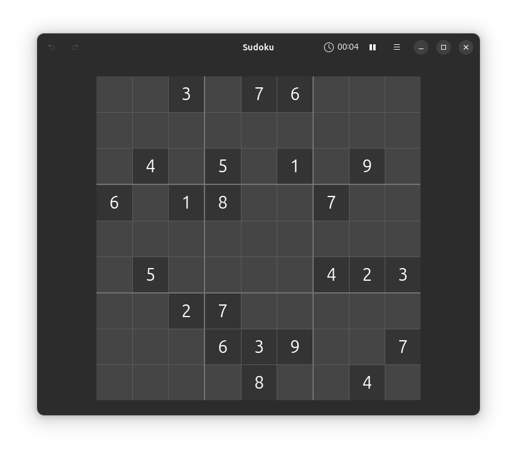

# Prolog Sudoku

A compact Sudoku solver written in SWI-Prolog. This university project shows
how constraint logic programming can express Sudoku rules clearly, without
manually implementing a backtracking algorithm.

## Features

- Solves standard 9x9 Sudoku puzzles with `library(clpfd)`
- Validates dimensions, cell values, and conflicting clues
- Checks whether a puzzle has exactly one solution
- Prints puzzles and solutions as readable terminal grids
- Includes automated tests and continuous integration

## Requirements

- [SWI-Prolog](https://www.swi-prolog.org/) 8.4 or newer

## Quick start

Clone the repository, enter its directory, and run:

```bash
swipl solve.pl
```

The program prints the example puzzle from `input.pl`, followed by its
solution. Empty cells are represented by `0` in code and `.` in the terminal.

## Use your own puzzle

A puzzle is a list of nine rows, each containing nine integers from 0 to 9.
Zero represents an empty cell.

```prolog
?- [sudoku].
?- Puzzle = [[5,3,0,0,7,0,0,0,0],
             [6,0,0,1,9,5,0,0,0],
             [0,9,8,0,0,0,0,6,0],
             [8,0,0,0,6,0,0,0,3],
             [4,0,0,8,0,3,0,0,1],
             [7,0,0,0,2,0,0,0,6],
             [0,6,0,0,0,0,2,8,0],
             [0,0,0,4,1,9,0,0,5],
             [0,0,0,0,8,0,0,7,9]],
   solve(Puzzle, Solution),
   print_board(Solution).
```

Useful predicates:

| Predicate | Purpose |
| --- | --- |
| `solve(+Puzzle, -Solution)` | Find a solution |
| `valid_puzzle(+Puzzle)` | Check shape, values, and clue conflicts |
| `solved_board(+Board)` | Check a completed board |
| `unique_solution(+Puzzle, -Solution)` | Require exactly one solution |
| `print_board(+Board)` | Print a board |

## Tests

Run the test suite with:

```bash
swipl -g run_tests -t halt test_sudoku.pl
```

## Project structure

```text
.
├── sudoku.pl          # Solver, validator, and board printer
├── input.pl           # Example puzzle
├── solve.pl           # Command-line demonstration
├── test_sudoku.pl     # Unit tests
├── screenshots/       # Project screenshot
├── CONTRIBUTING.md
├── LICENSE
└── README.md
```

## Screenshot



## Contributing

Bug reports, explanations, test cases, and focused improvements are welcome.
Please read [CONTRIBUTING.md](CONTRIBUTING.md) before opening a pull request.

## License

Released under the [MIT License](LICENSE).
